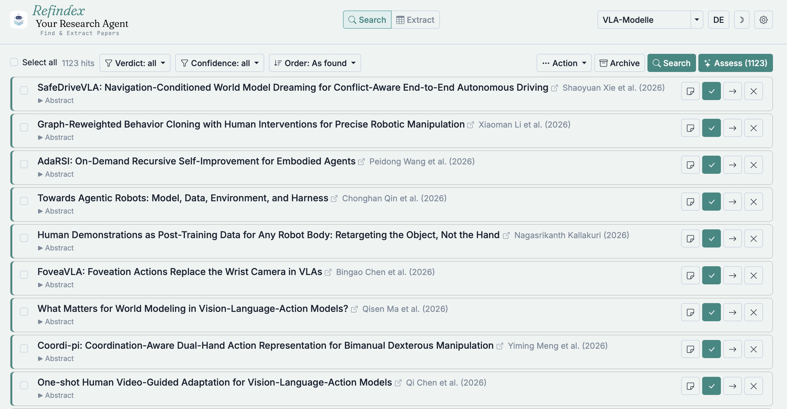
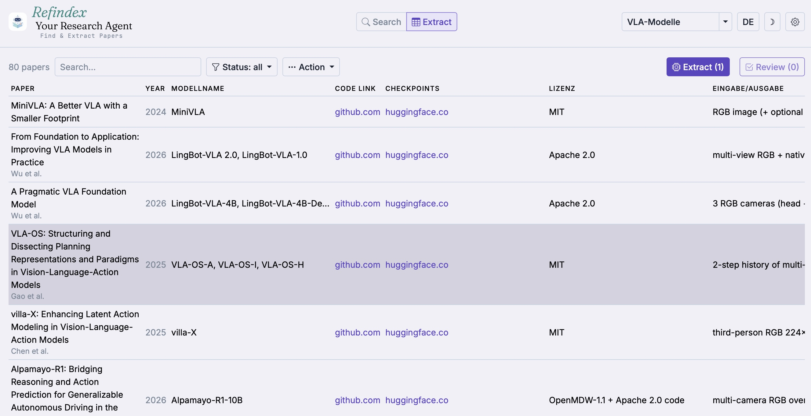

# Refindex

**Find the papers that matter, and get the data you need out of them, without
losing track of where each value came from.**

> ### Coming soon
> The source code will be published in this repository on **10 November 2026**.
> Watch this repository to be notified when it is released.

---

## What it is

Refindex is a local research assistant for literature work. It searches for papers,
has a language model judge their relevance against your research interest, saves the
ones you keep to Zotero, and extracts the data you define into a table. Every value
comes with the exact quote and the page it was taken from. Refindex does not replace
your reference manager, it works on top of Zotero.

Everything runs **on your own machine**: no account, no server, no cloud. The
language model can be local too (Ollama), or OpenAI / Anthropic over an API key.
Interface in English.

## How it works

**Search.** You describe your research interest in your own words: what you are
looking for, what makes a paper relevant, and what does not. Refindex searches arXiv
by keyword and asks Semantic Scholar for recommendations, seeded with the papers you
have already kept and rejected.

**Assess.** A language model weighs every hit against your research interest and
explains its verdict. You decide: relevant, related, or rejected. What you keep goes
into your Zotero collection, and what you have handled never comes back. You never
write a prompt. Every instruction the model gets is built from your description.

**Extract.** You define the columns of your table: a name, a type, and a description
in your words. Refindex reads the PDF from Zotero and proposes a value for each
column, with the exact quote and the page it was taken from. You review every
proposal, and nothing lands in the table unseen. Page numbers open the PDF at that
page, and the table exports to CSV.

## Status

Refindex was built for, and is used daily on, a literature review of open-source
vision-language-action models at HTW Berlin, where it has screened and extracted a
few hundred papers. It is tested on macOS only and is single-user by design. Known
limitations and the roadmap will be in the README that replaces this page.

## Built with

Python and Flask with a SQLite database. Zotero over its local API. Language models
through Ollama, OpenAI or Anthropic.

## Author

Anne Kochs, HTW Berlin.

Refindex stands on [Zotero](https://www.zotero.org), the
[`zotero-local-write-api`](https://github.com/dzackgarza/zotero-local-write-api)
add-on by dzackgarza, [arXiv](https://arxiv.org) and the
[Semantic Scholar API](https://www.semanticscholar.org/product/api).
